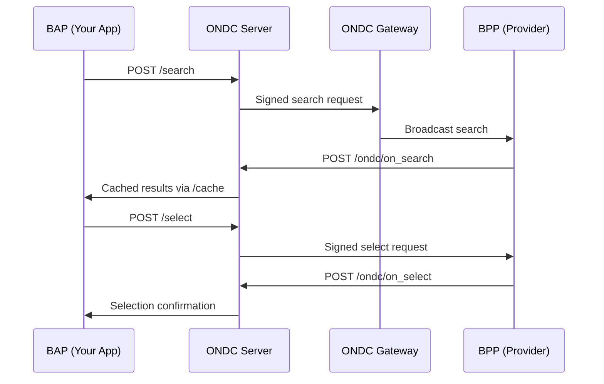

# ONDC Transportation Server

[](https://nodejs.org/)
[](https://expressjs.com/)
[](https://ondc.org/)

A robust Node.js server implementation for ONDC (Open Network for Digital Commerce) transportation and mobility services, built with BECKN protocol compliance and digital signature support.

## 🚀 Quick Start

### Prerequisites
- Node.js v14 or higher
- npm or yarn package manager
- ONDC network registration (BAP ID and signing keys)

### Installation
```bash
# Clone the repository
git clone <repository-url>
cd ondc-server

# Install dependencies
npm install

# Set up environment variables
cp .env.example .env
# Edit .env with your ONDC credentials

# Start the server
npm start
```

### Environment Setup
Create a `.env` file with your ONDC credentials:
```env
PORT=3000
PRIVATE_KEY=your_base64_encoded_private_key
BAPID=your_registered_bap_id
UNIQUE_KEY=your_unique_key_identifier
GATEWAY_URL=https://staging.gateway.proteantech.in/
callbackUrl=https://your-domain.com
ENABLE_SIGNATURE_VALIDATION=true
```

## 🏗️ Architecture

This server provides two main interaction patterns:

### 1. Direct ONDC Protocol APIs
Standard BECKN protocol endpoints for direct integration:
- `/search` - Search for transportation services
- `/select` - Select specific service offerings
- `/init` - Initialize booking process
- `/confirm` - Confirm and complete booking
- `/status` - Check order status
- `/cancel` - Cancel bookings

### 2. JSON Mapper System  
Simplified business-friendly APIs that handle BECKN protocol complexity:
- `/mapper/session` - Create mapping sessions
- `/mapper/:config` - Execute protocol calls with business payloads
- `/mapper/timeout` - Handle timeout scenarios

## 📡 API Overview

### Core Endpoints

| Endpoint | Method | Description | 
|----------|--------|-------------|
| `/createHeader` | POST | Generate ONDC authorization headers |
| `/:method` | POST | Execute ONDC protocol methods |
| `/ondc/:method` | POST | Handle ONDC callbacks |
| `/cache` | GET/DELETE | Manage transaction cache |
| `/mapper/session` | POST | Create JSON mapper session |
| `/mapper/:config` | POST | Execute mapped protocol calls |

### Quick Example

```javascript
// Search for metro services
const response = await fetch('/search', {
  method: 'POST',
  headers: { 'Content-Type': 'application/json' },
  body: JSON.stringify({
    context: {
      bap_uri: "https://your-callback.com/ondc/",
      transaction_id: "uuid-v4",
      action: "search",
      domain: "ONDC:TRV11"
    },
    message: {
      intent: {
        fulfillment: { vehicle: { category: "METRO" } }
      }
    }
  })
});
```

## 🔧 Features

- ✅ **ONDC Protocol Compliance** - Full BECKN protocol implementation
- ✅ **Digital Signatures** - Automatic signature generation and verification  
- ✅ **Multiple Transport Types** - Support for Metro, Cab, Auto-rickshaw
- ✅ **JSON Mapping** - Business-friendly API layer
- ✅ **Request Caching** - Transaction history and debugging
- ✅ **Configuration Management** - YAML-based flow configurations
- ✅ **Error Handling** - Comprehensive error responses
- ✅ **CORS Support** - Cross-origin resource sharing

## 📚 Documentation

- **[Complete API Documentation](./API_DOCUMENTATION.md)** - Detailed documentation for all endpoints, functions, and utilities
- **[Configuration Guide](./configs/)** - YAML configuration examples and setup
- **[Usage Examples](./API_DOCUMENTATION.md#usage-examples)** - Practical implementation examples

## 🛠️ Configuration

The server supports multiple transportation flow configurations:

```
configs/
├── index.yaml              # Main configuration
├── metro-flow-1/           # Metro transportation flow
│   ├── protocolCalls.yaml  # Protocol call definitions
│   ├── input.yaml          # Input field mappings
│   └── protocolMapping.yaml # Business-to-BECKN mappings
├── metro-flow-2/           # Alternative metro flow
└── ondemand-flow-1/        # On-demand transportation
```

## 🔐 Security

### Digital Signatures
All ONDC requests require digital signatures for authentication:
- Automatic signature generation using ONDC crypto SDK
- Signature verification for incoming requests
- Public key lookup from ONDC registry

### Environment Security
- Sensitive credentials stored in environment variables
- Private keys encoded in Base64 format
- Optional signature validation toggle

## 📊 Supported Transportation Types

| Vehicle Type | ONDC Domain | Description |
|-------------|-------------|-------------|
| Metro | ONDC:TRV11 | Metro rail transportation |
| Cab | ONDC:TRV11 | Taxi/cab services |
| Auto-rickshaw | ONDC:TRV11 | Three-wheeler services |
| Bus | ONDC:TRV11 | Public bus transportation |

## 🔄 ONDC Flow Example



## 🧪 Testing

### Basic Health Check
```bash
curl -X POST http://localhost:3000/createHeader \
  -H "Content-Type: application/json" \
  -d '{"context":{"action":"search"}}'
```

### Cache Operations
```bash
# Get transaction data
curl "http://localhost:3000/cache?transactionid=your-transaction-id"

# Clear transaction cache  
curl -X DELETE "http://localhost:3000/cache?transactionid=your-transaction-id"
```

## 📁 Project Structure

```
├── app.js                  # Main application entry
├── header.js              # Authentication header generation  
├── router/
│   └── route.js           # API route definitions
├── utils/
│   ├── utils.js           # Cache and utility functions
│   ├── buildPayload.js    # Payload transformation
│   └── response.js        # Response templates
├── configs/
│   ├── index.js           # Configuration loader
│   └── */                 # Flow-specific configs
└── package.json           # Dependencies and scripts
```

## 🤝 Contributing

1. Fork the repository
2. Create a feature branch: `git checkout -b feature-name`
3. Make your changes and add tests
4. Commit your changes: `git commit -am 'Add feature'`
5. Push to the branch: `git push origin feature-name`
6. Submit a pull request

## 📝 License

This project is licensed under the ISC License - see the [LICENSE](LICENSE) file for details.

## 🆘 Support

- **Documentation**: [API_DOCUMENTATION.md](./API_DOCUMENTATION.md)
- **ONDC Specifications**: [ONDC Network](https://ondc.org/)
- **BECKN Protocol**: [BECKN Protocol](https://beckn.org/)

## 🚧 Roadmap

- [ ] Enhanced error handling and logging
- [ ] Metrics and monitoring integration
- [ ] Additional transportation domain support
- [ ] Performance optimizations
- [ ] Docker containerization
- [ ] API rate limiting
- [ ] Webhook retry mechanisms

---

**Built for ONDC Network** | **BECKN Protocol Compliant** | **Production Ready**